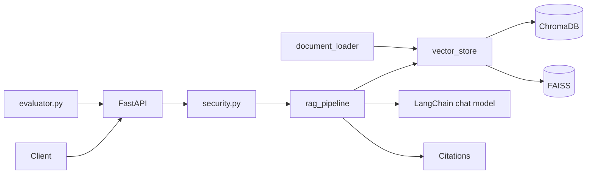

# Enterprise RAG Assistant

Portfolio project by [Alexandru Cojocari](https://github.com/DatadrivenAlex).

A small production-shaped retrieval assistant. It indexes company documents, answers a question from those documents, and returns the passage it used. Prompt-injection attempts in the question or in a retrieved passage are refused or dropped. The default setup runs entirely offline: hash embeddings, an extractive LangChain chat model, and lexical evaluation. No API key is required.

The sample corpus is fictional material for Helios Analytics, written so the service can be demonstrated without anyone's private documents.

## What it shows

- Document loading with overlapping chunks and source metadata
- A vector-store adapter with ChromaDB and FAISS implementations
- A LangChain chain (`prompt | chat model | parser`) that cites sources
- Guardrails for instruction override, delimiter breakout, and canary leakage
- Evaluation metrics for faithfulness, relevancy, context precision, and citations
- A FastAPI service, pydantic-settings configuration, Docker, and offline pytest

## Architecture



Ingest splits markdown and text, drops chunks that look like instruction overrides, and upserts the rest. A query is screened first. Retrieval then runs, poisoned passages are quarantined, and the remaining text is wrapped as untrusted data. The chat model must answer from that data and cite `[n]`. The response always includes structured citations unless the model found nothing or the answer was withheld.

## Quick start

Python 3.11 or 3.12.

```bash
python -m venv .venv
source .venv/bin/activate
pip install -r requirements-dev.txt
make run
```

On startup the service indexes `data/sample_docs/` when that directory sits inside the data directory. Then:

```bash
curl -s http://127.0.0.1:8000/health

curl -s http://127.0.0.1:8000/api/v1/query \
  -H 'content-type: application/json' \
  -d '{"question": "How many paid vacation days do employees receive?"}'
```

The answer should mention 28 days and cite `employee_handbook.md`.

Interactive API docs are at `http://127.0.0.1:8000/docs`.

## Tests

The suite does not call OpenAI and does not download an embedding model.

```bash
pytest
```

## Docker

```bash
docker compose up --build
```

The container uses the same offline defaults and indexes the sample documents on startup. The Chroma directory is stored in the `rag-index` volume.

To use a hosted model instead, export a key and override the providers:

```bash
export RAG_OPENAI_API_KEY="sk-..."
export RAG_CHAT_PROVIDER=openai
export RAG_EMBEDDING_PROVIDER=openai
docker compose up --build
```

Changing the embedding provider changes the vector space. Delete the volume before reindexing if you switch providers or dimensions.

## Configuration

Settings come from the environment and an optional `.env` file. Every variable uses the `RAG_` prefix. See `.env.example` for the full list.

| Variable | Default | Purpose |
| --- | --- | --- |
| `RAG_CHAT_PROVIDER` | `extractive` | `extractive` quotes retrieved sentences. `openai` calls chat completions. |
| `RAG_EMBEDDING_PROVIDER` | `hash` | `hash` is local and deterministic. `openai` calls the embeddings API. |
| `RAG_VECTOR_BACKEND` | `chroma` | `chroma` or `faiss`. |
| `RAG_VECTOR_PERSIST` | `true` | Persist the index under the data directory. |
| `RAG_AUTO_INGEST_DIR` | `sample_docs` | Relative directory indexed on startup. Empty disables it. |
| `RAG_TOP_K` | `4` | Passages retrieved per question. |
| `RAG_CHUNK_SIZE` | `800` | Characters per chunk. Overlap must be smaller. |
| `RAG_API_KEY` | empty | When set, `/api/v1/*` requires header `X-API-Key`. `/health` stays open. |
| `RAG_OPENAI_API_KEY` | empty | Required only when a provider is `openai`. |

Hash embeddings match shared words. They are the right default for this sample and for tests. They are a weak semantic search. Switch the embedding provider before using a large corpus where questions will not reuse the document's wording.

Run one Uvicorn worker. These in-process indexes are not a multi-writer database.

## HTTP API

| Method | Path | Purpose |
| --- | --- | --- |
| `GET` | `/health` | Liveness. |
| `GET` | `/ready` | Readiness. Checks that the vector store responds. |
| `POST` | `/api/v1/ingest` | Index a file or directory inside the data directory. |
| `POST` | `/api/v1/ingest/upload` | Upload `.md`, `.markdown`, or `.txt` files. |
| `POST` | `/api/v1/query` | Ask a question. Returns an answer and citations. |
| `POST` | `/api/v1/evaluate` | Score an answer against contexts. |
| `GET` | `/api/v1/sources` | List indexed sources and the chunk count. |

Ingest body:

```json
{"path": "sample_docs"}
```

Query body:

```json
{"question": "How long are customer analytics records retained?", "top_k": 4}
```

A refused question returns HTTP 200 with `"refused": true` and a short message. The attack text is not echoed. Paths that leave the data directory return HTTP 400.

Evaluation body:

```json
{
  "question": "How many paid vacation days do employees receive?",
  "answer": "Employees receive 28 paid vacation days per year. [1]",
  "contexts": ["Employees receive 28 paid vacation days per year."],
  "ground_truth": "Employees receive 28 paid vacation days per year."
}
```

`use_llm_judge` defaults to false. When true, the configured chat model is asked for JSON scores through a LangChain prompt. If that output is not JSON, the lexical scores are kept.

## Metrics

| Metric | Meaning |
| --- | --- |
| Faithfulness | Share of answer words that also appear in the retrieved context. |
| Answer relevancy | Share of question words that also appear in the answer. |
| Context precision | Share of passages that overlap the question. |
| Citation support | Share of `[n]` markers that point at a retrieved passage. |
| Context recall | Present when a ground-truth answer is supplied. Share of its words found in the context. |
| Answer correctness | Token F1 between the answer and the ground truth, when ground truth is supplied. |

Stopwords are ignored. These are transparent overlap scores, not a claim that a model judged the answer.

## Project layout

```text
src/enterprise_rag/
  main.py              FastAPI app, health, startup ingest
  routes.py            Ingest, query, evaluate, sources
  config.py            pydantic-settings
  document_loader.py   Chunking and metadata
  vector_store.py      ChromaDB and FAISS adapters, embeddings
  rag_pipeline.py      LangChain chain and citations
  security.py          Prompt-injection guardrails
  evaluator.py         Offline metrics and optional LLM judge
  schemas.py           Request and response models
data/sample_docs/      Fictional Helios policies and product notes
tests/                 Offline pytest suite
```

## Sample corpus

| File | Facts the demo asks about |
| --- | --- |
| `employee_handbook.md` | 28 vacation days, 3 remote days per week, 16 weeks of parental leave |
| `information_security_policy.md` | Incidents go to security@helios.example within 1 hour, MFA required |
| `data_retention_policy.md` | Customer analytics kept 24 months, tickets 36 months |
| `product_overview.md` | What Helios Insights will and will not answer |

## License

MIT. Copyright Alexandru Cojocari.
